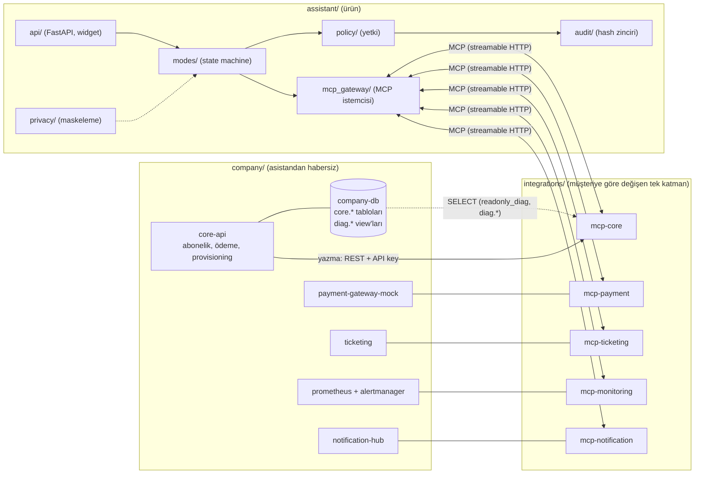
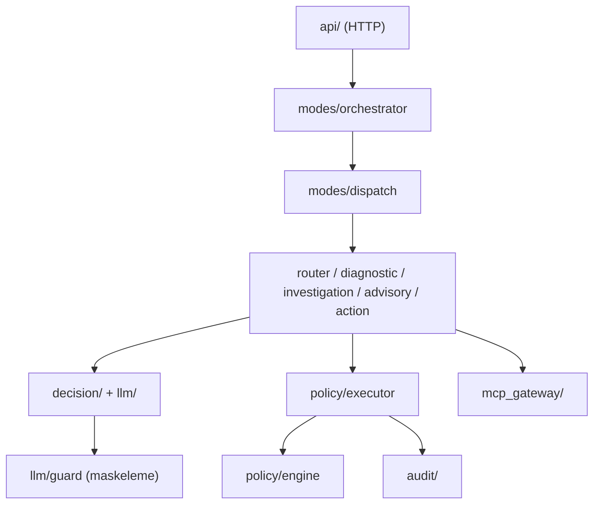

# 01. Mimari Turu

Bu bölümün sonunda şunları anlatabiliyor olmalısın:

1. Repodaki üç klasör grubu (`company/`, `integrations/`, `assistant/`) neden ayrı?
2. Hangi kural hangi test veya mekanizma ile **mekanik olarak** zorlanıyor?
3. Aynı kodu başka bir müşteriye uyarlamak için nereye dokunulur?

## 1. İki dünya + bir köprü

Fikir şu: Bir şirket sana "destek asistanı yaz" dediğinde onun veritabanını, kodunu ve iç
servislerini **sen yazmadın**; sadece onların sana açtığı kapılardan konuşabilirsin. Repo bu
gerçeği klasör yapısına yansıtıyor.

| Klasör | Rol | Neyi bilir? |
|---|---|---|
| `company/` | NetSwift'in kendi sistemi: `core-api`, `provisioning-worker`, `payment-gateway-mock`, `ticketing`, `notification-hub`, `monitoring`, `chaos` | Asistanı **bilmez** |
| `integrations/` | Her şirket sistemi için bir **MCP sunucusu** (adapter): `mcp_core`, `mcp_payment`, `mcp_ticketing`, `mcp_monitoring`, `mcp_notification` + ortak `common/` | İki tarafı da bilir ama sadece "çevirmen" olarak |
| `assistant/` | Ürün: sohbet motoru, policy engine, audit log, maskeleme, öneri motoru, widget | NetSwift'in iç yapısını **bilmez**, sadece tool'lar üzerinden konuşur |
| `config/tenants/<müşteri>/` | Müşteriye özel ayarlar (adapter adresleri, policy, yönlendirme) | |

MCP (Model Context Protocol), bir uygulamanın "tool" olarak adlandırılan fonksiyonlarını ağ
üzerinden standart bir biçimde sunmasının yolu. `integrations/mcp_*` sunucuları şirketin
REST API'lerini ve salt-okunur SQL view'larını tool'lara çevirir; `assistant/` ise bunları MCP
istemcisi olarak çağırır (`assistant/mcp_gateway/gateway.py`).

### Katman diyagramı

Okuma ipucu: oklar **bağımlılık yönünü** gösteriyor. `company/` hiçbir şeyi import etmez;
`assistant/` şirkete sadece MCP üzerinden ulaşır; yazma işlemleri yalnızca şirketin kendi
REST API'si üzerinden (API key ve scope ile) olur.

### Neden böyle ayrıldı?

- **Ticari gerçeklik:** Ürünü sattığın şirketin kodunu değiştirmene izin verilmez. Ayrım bunu
  prova ediyor.
- **Müşteri değişimi ucuz olsun:** İkinci müşteri geldiğinde değişen şey `integrations/` ve
  `config/tenants/<ad>/` olmalı, `assistant/` değil.
- **Güvenlik:** Asistanın yanlışlıkla veya bir prompt injection ile şirket verisini bozması
  mümkün olmamalı. "Dikkatli yazdık" yetmez; **mekanik** engel gerekir (bkz. aşağıdaki tablo).

## 2. Değişmezler (invariants) ve onları zorlayan mekanizmalar

"Değişmez", her zaman doğru olması gereken kural demek. İyi bir değişmez, biri unutsa bile CI'ın
yakaladığı bir kuraldır. Aşağıda `CLAUDE.md` içindeki sekiz kuralı ve bunlara eşlik eden birkaç
ek korumayı, **neyin zorladığıyla** birlikte listeledik.

| # | Kural | Zorlayan mekanizma |
|---|---|---|
| 1 | `assistant/` içindeki hiçbir dosya `company`, `shared`, `integrations` veya `common` import etmez | `tests/architecture/test_boundaries.py::test_import_boundaries`: tüm `.py` dosyalarını AST ile tarar, `FORBIDDEN_IMPORTS` tablosuyla karşılaştırır |
| 2 | `company/` içindeki hiçbir dosya `assistant` veya `integrations` import etmez (aynı şekilde `integrations/` da `assistant` ve `company` import etmez) | Aynı test (`FORBIDDEN_IMPORTS` üç dünya için tanımlı) |
| 3 | `company/` içinde `assistant`, `advisor`, `chatbot`, `llm`, `openai`, `anthropic`, `langfuse`, `mcp` kelimeleri geçmez: kod, SQL, şablon, config fark etmez | `test_company_code_never_mentions_the_assistant`: regex ile tüm dosyalarda arar. Tek istisna `company/monitoring/alertmanager.yml` içindeki `mcp` ve o da tabloda açıkça yazılı (`TOKEN_ALLOWANCES`) |
| 4 | Asistan kodunda şirket hostname'i sabit yazılmaz | `test_assistant_never_hardcodes_company_endpoints`; adresler `config/tenants/<ad>/tenant.yaml` + ortam değişkeninden gelir (`${MCP_CORE_URL}` gibi) |
| 5 | Entegrasyon katmanı şirket DB'sine **yazamaz** | `readonly_diag` rolü yalnızca `diag.*` view'larında `SELECT` yetkisine sahip; `core.*` tamamen kapalı (`company/core-api/app/bootstrap.py`, `_grant_statements`). Testi: `tests/integration/test_readonly_role.py` (`test_base_tables_are_unreachable`, `test_every_write_is_refused_by_the_database`). Kodda ikinci kemer: `integrations/common/readonly_db.py` hem `READ ONLY` transaction açar hem de `SELECT/WITH` dışındaki ifadeleri reddeder |
| 6 | Modelin yetkisini model belirlemez | `assistant/policy/engine.py` `policy.yaml`'ı yorumlar; listede olmayan aksiyon reddedilir (**default-deny**). `assistant/policy/executor.py` aksiyonu policy kontrolü olmadan çalıştıracak bir yol bırakmaz. Testler: `assistant/policy/tests/` |
| 7 | Geri alınamaz aksiyonlar (para, iptal) açık kullanıcı onayı ister | `policy.yaml` içinde `requires_confirmation: true` (örn. `apply_outage_credit`); executor `ConfirmationRequired` fırlatır, `modes/action/known_causes.py` bunu onay kartına çevirir (`modes/approvals.py`) |
| 8 | PII, model sağlayıcıya, trace'e ve ticket'a gitmeden maskelenir | `assistant/privacy/masking.py`; arkasında iki yedek: `assistant/llm/guard.py` (`MaskingProvider` ham PII görürse `PIILeakError` ile durur) ve `audit/log.py` (`assert_no_pii`). Testler: `assistant/privacy/tests/`, `assistant/modes/tests/test_pii.py`, `assistant/llm/tests/test_guard.py` |
| 9 | Audit log değiştirilemez | Postgres'te `BEFORE UPDATE OR DELETE` **trigger'ı** (`assistant/core_common/db.py`, `AUDIT_APPEND_ONLY_TRIGGER_SQL`) + hash zinciri (`assistant/audit/log.py`). Testler: `tests/integration/test_audit_append_only.py`, `assistant/audit/tests/` |
| 10 | Müşteri kimliği sadece cookie'den gelir | `assistant/api/security.py::session_customer`; gövdedeki `customer_no` yok sayılır. Başkasının konuşmasına erişim 403 (`require_conversation_access`). Testler: `assistant/api/tests/test_ownership.py` |
| 11 | Webhook'lar imzasız kabul edilmez | `verify_webhook_signature` (HMAC + `compare_digest`), `WEBHOOK_SECRET` yoksa 401 (fail closed). Test: `assistant/api/tests/test_webhooks.py` |

### Bu tabloyu nasıl okumalı?

Üç farklı güvence seviyesi var ve hepsini ayırt etmek önemli:

1. **Kod seviyesi, statik:** 1–4. kurallar. Test dosyaları kaynak kodu tarar; kural çiğnenirse
   PR kırmızı olur.
2. **Altyapı seviyesi:** 5 ve 9. kurallar. Kod hatalı olsa bile **veritabanı** reddeder. En
   güçlü savunma budur, çünkü uygulama kodunun hatasından bağımsızdır.
3. **Tasarım seviyesi:** 6, 7, 8. kurallar. "Her yol tek bir kapıdan geçer" ilkesiyle zorlanır
   (örneğin aksiyonlar yalnızca `ActionExecutor` üzerinden). Burada test, kapının atlanmadığını
   doğrular.

> Dikkat: Testler yalnızca **test ettikleri şeyi** garanti eder. Örneğin kural 8'in maskeleme
> kapsamı İngiltere formatlarıyla sınırlı (bkz. `07-bilinen-sinirlar.md`).

## 3. `assistant/` içinde ne var? (kuş bakışı)

`assistant/` altındaki her alt klasör kendi başına bir **top-level Python paketi** (container'da
`PYTHONPATH=/app:/app/assistant`). Bu yüzden import'lar `from policy.engine import ...` biçiminde,
`from assistant.policy...` değil. İki isim bilerek farklı seçilmiş: `core_common` (`common`
olamaz, çünkü sınır testi `common` import'unu yasaklıyor) ve `mcp_gateway` (`mcp` olamaz, çünkü
kurulu MCP SDK'sını gölgelerdi).

| Paket | Tek cümle |
|---|---|
| `api/` | HTTP katmanı: `main.py` (app factory), `state.py` (composition root), `security.py`, `routes/` |
| `modes/` | Konuşma state machine'i: `orchestrator.py`, `dispatch.py`, `machine.py`, `router.py`, `diagnostic/`, `investigation/`, `action/`, `advisory/` |
| `policy/` | Yetki motoru (`engine.py`) ve aksiyon çalıştırıcı (`executor.py`) |
| `decision/` | LLM'den yapılandırılmış karar alma (`llm_structured.py`) ve güven eşiği (`fallback.py`) |
| `llm/` | Sağlayıcı arayüzü (`base.py`) + OpenAI / Anthropic / scripted + maskeleme koruması (`guard.py`) |
| `recommendation/` | Deterministik paket puanlama |
| `privacy/` | PII maskeleme |
| `audit/` | Hash zincirli audit log |
| `mcp_gateway/` | MCP istemcisi, tool bütçesi, tool audit |
| `tickets/` | Yapılandırılmış ticket oluşturma |
| `observability/` | Langfuse/OTel sarmalayıcısı (kapalıyken no-op) |
| `core_common/` | Ortak tipler, ayarlar, tenant config modelleri, assistant DB modelleri |
| `web/` | Sohbet widget'ı (Jinja + vanilla JS) |

Başlangıç noktası olarak `assistant/api/state.py` iyi: **composition root** burası. Yani somut
nesnelerin (provider, gateway, audit log, orchestrator) yaratılıp birbirine bağlandığı tek yer.
Geri kalan kod hazır bağımlılıkları parametre olarak alır.

### Bağımlılık yönü içeride de var

Handler'lar kendi nesnelerini yaratmaz; `TurnContext` (`assistant/modes/context.py`) içinde
hazır alırlar. Bu sayede testlerde gerçek MCP yerine `FakeGateway`, gerçek model yerine
`ScriptedProvider` verebilirsin.

## 4. Çoklu kiracı (multi-tenancy)

Multi-tenancy burada "aynı kod, farklı müşteri ayarı" anlamında. Bir müşteri =
`config/tenants/<ad>/` altında üç dosya:

| Dosya | İçeriği |
|---|---|
| `tenant.yaml` | Müşteri adı, müşteri numarası formatı (`customer_identifier.pattern`), adapter adresleri (ortam değişkeninden), departmanlar, persona |
| `policy.yaml` | Asistanın hangi aksiyonları yapabileceği, koşullar, limitler, PII ayarları |
| `routing.yaml` | Sorun tipi → departman tablosu, öneri ağırlıkları, `investigation_tools` allowlist'i |

Hangi müşterinin kullanılacağını `TENANT` ortam değişkeni belirler (`.env.example` içinde
`TENANT=netswift`). `config/tenants/_example/` boş bir şablon değil, **çalışan ikinci bir
müşteri**: farklı numara formatı (`OR-2045118`), farklı departman adları, daha yüksek devir
eşiği (0.8), tazminat yetkisi yok. Aynı imajı `TENANT=_example` ile
çalıştırıp farkı görebilirsin (komut `config/tenants/_example/README.md` içinde). Dürüst sınır orada
da yazıyor: `IssueType` ve `Department` enum'ları kodda tanımlı; başka bir *sektöre* geçmek için
bu sözlük de genişlemeli, başka bir *internet sağlayıcıya* geçmek için yalnızca config yeter.

Login formunun etiketi ve doğrulama kalıbı bile tenant'tan gelir (`assistant/api/routes/auth.py`
`state.tenant_config.tenant.customer_identifier.pattern` okur). Yani "ürün yüzeyi de müşteriye
bağlı olmamalı" kuralı gerçekten uygulanmış.

> Dürüst sınır: Tüm tenant'lar aynı süreçte aynı anda çalışmıyor; bir süreç **bir** tenant ile
> açılır. Gerçek bir SaaS'ta istek başına tenant seçimi gerekirdi (bkz. `07-bilinen-sinirlar.md`
> ve `config/tenants/_example/README.md`).

## 5. Kendini sına

1. `assistant/` içindeki bir dosyaya `import shared` eklersen hangi test kırılır? Hangi satır
   bunu yakalar?
2. `readonly_diag` rolüne yanlışlıkla `core` şemasında `SELECT` verirsen hangi test kırılır?
3. Neden "kod içinde `if action in allowed` kontrolü" yerine veritabanı rolü ve policy engine
   kullanıyoruz? (İpucu: kodun hatalı olduğu durumu düşün.)
4. Yeni bir müşteri için hangi dosyalar eklenir, hangileri **değişmez**?

Sonraki bölüm: `02-bir-mesajin-yolculugu.md`.
