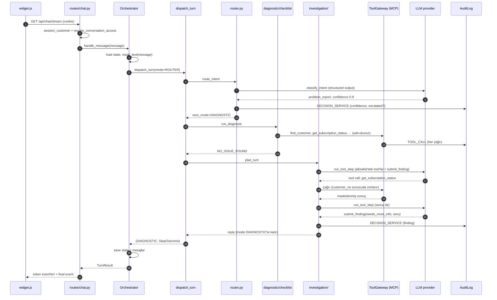

# 02. Bir Mesajın Yolculuğu

Bu bölümde tek bir müşteri mesajını, tarayıcıdan cevaba kadar **dosya dosya** izliyoruz.
Satır numaraları bu commit için doğrulandı; kod ilerledikçe birkaç satır kayabilir, bu yüzden
her referansta fonksiyon adını da veriyoruz. Aramak için: `grep -n "def handle_message" assistant/modes/orchestrator.py`.

Önce kuş bakışı. Bir müşteri mesajı şu zincirden geçer:

```text
widget.js
  -> api/routes/chat.py              (HTTP; kimlik cookie'den)
     -> api/security.py              (konuşma sahipliği)
        -> modes/orchestrator.py     (tur yaşam döngüsü: yükle, maskele, çalıştır, kaydet)
           -> modes/dispatch.py      (mode döngüsü; her geçiş state machine'den onay alır)
              -> modes/router.py                 (niyet sınıflandırma + güven eşiği)
              -> modes/diagnostic/               (sabit checklist, deterministik)
              -> modes/investigation/            (checklist bir şey bulamazsa: LLM + salt-okunur tool'lar)
              -> modes/action/                   (policy engine kontrolü, aksiyon veya ticket)
        -> audit/log.py              (her adım hash zincirine yazılır)
```

Üç terimi baştan netleştirelim:

- **Mode:** Konuşmanın o anki durumu (`ROUTER`, `ADVISORY`, `DIAGNOSTIC`, `STATUS_QUERY`,
  `ACTION`, `AWAITING_APPROVAL`, `ESCALATED`, `CLOSING`). `assistant/core_common/types.py` içindeki `Mode` enum'u.
- **State machine:** Hangi mode'dan hangisine geçilebileceğini bir tablo (`ALLOWED_TRANSITIONS`,
  `assistant/modes/machine.py:30`) belirler. Tabloda olmayan geçiş `IllegalTransition` fırlatır.
- **Turn (tur):** Müşterinin bir mesajı + asistanın tek cevabı. Bir turun içinde birden fazla mode
  değişebilir (aşağıda göreceksin).

---

## Ortak başlangıç: mesaj sunucuya kadar nasıl gelir?

1. **Widget** (`assistant/web/static/widget.js`). `sendViaStream` (satır 341) önce
   `new EventSource("/api/chat/stream?...")` açar (satır 355). Akış hata verirse aynı mesajı
   `sendViaPost` ile (satır 315, `fetch("/api/chat")`) bir kez daha dener.
   *SSE (Server-Sent Events)*, sunucunun tek bir HTTP bağlantısı üzerinden tarayıcıya sürekli
   `event:` / `data:` satırları göndermesi. WebSocket'ten basit, çünkü veri sadece tek yönlü akıyor.
2. **Endpoint** (`assistant/api/routes/chat.py`): `api_chat` (satır 50) ve `api_chat_stream`
   (satır 67). İkisi de önce `session_customer(request)` ile müşteri kimliğini **cookie'den** alır.
   İstek gövdesindeki `customer_no` alanı geriye uyumluluk için kabul edilir ama **yok sayılır**;
   yoksa herkes başkası olduğunu iddia edebilirdi.
3. **Sahiplik kontrolü** (`assistant/api/security.py`, `require_conversation_access`, satır 54):
   konuşma başka bir müşteriye bağlıysa **403**. Bu kontrol orchestrator çalışmadan önce
   yapılır, yani yabancı bir konuşmaya hiç dokunulmaz (`chat.py:59`).
4. **Orchestrator** (`assistant/modes/orchestrator.py`, `handle_message`, satır 83):
   - `self.store.load` ile konuşma durumunu (`ConversationState`) veritabanından yükler.
   - `mask_text(message).masked` (satır 96): **model, trace, audit veya depolama hiçbir şey ham
     metni görmeden önce** PII maskelenir. Bu sıra bilerek böyle.
   - `build_ctx` (satır 173) bu tur için taze bir `TurnContext` kurar: tur başına kendi gateway
     görünümü ve kendi **tool bütçesi** (`_scope`, satır 190). Böylece bir konuşma başkasının
     tool hakkını harcayamaz.
   - `dispatch_turn` (satır 115) çağrılır; `LimitExceeded` ve `ToolBudgetExceeded` yakalanıp
     (satır 118 ve 124) kibar bir "bir yetkiliye aktarıyorum" cevabına çevrilir, hata sayfasına değil.
     (`ToolBudgetExceeded` tool bütçesini aşan tur içinde gateway'den, `LimitExceeded` ise
     konuşmanın `max_actions_per_conversation` hakkı dolduğunda `ActionExecutor`'dan fırlar.)
   - Sonunda geçmiş, mode ve mesajlar kaydedilir (`self.store.save`, satır 147).

Buradan sonrası `modes/dispatch.py`.

### `dispatch_turn`: bir döngü, zincir değil

`dispatch_turn` (`assistant/modes/dispatch.py`) bir `while True` döngüsü. Bir handler "şimdi X
mode'una geç" derse döngü aynı turun içinde X'i çalıştırır, böylece müşteri boş bir cevap yerine
tek bir anlamlı cevap alır. Döngü `_MAX_HOPS = 5` (satır 31) ile sınırlı; bir geçiş hatası
sonsuz döngü yaratamasın diye. Her geçiş `machine.transition(...)` üzerinden geçer.

---

## Senaryo A: "My internet is slow in the evenings" (bilinmeyen sorun, investigation)

Müşteri giriş yapmış (`NS-100001`) ve yeni bir konuşmada şunu yazıyor:

> My internet is slow in the evenings.

Bu mesajın şirket sistemlerinde bilinen bir arıza kalıbı **yok**; ne takılı bir provisioning işi
ne çift çekim ne de bölgesel bir kesinti var. Bu tür "tanıyamadığımız" şikâyetler için projede
ikinci aşama olan ajan tabanlı **investigation** var.

### Sıra diyagramı



### Adım adım

**1. Router: niyet sınıflandırma ve güven eşiği.**
`dispatch_turn` mode `ROUTER` olduğu için `route_intent(ctx, masked_message)` çağırır
(`dispatch.py:70-71`, tanım `modes/router.py:56`).

- `ctx.decision_service.classify_intent(...)` bir **structured output** LLM çağrısı yapar:
  cevap serbest metin değil `{value, confidence, rationale}` biçiminde bir nesnedir
  (`assistant/decision/llm_structured.py`). `value` bir `Intent` enum'una karşı doğrulanır;
  enum dışı bir cevap güven 0'lı güvenli bir karara dönüşür, exception olmaz.
- `apply_confidence_floor` (`router.py:77`, tanım `decision/fallback.py`) güveni
  `policy.yaml: decision.min_confidence` (netswift için `0.6`) ile karşılaştırır. Eşiğin altında
  router tahmin yürütmez, **insana devreder** (`router.py:94`). "Model çöktü" ile "müşteri
  anlaşılmadı" için farklı cevaplar vardır (`HANDOVER_PROVIDER_DOWN` / `HANDOVER_UNSURE` in `modes/replies.py`).
- Bizim mesajda niyet `problem_report`, yüksek güven; `_INTENT_TO_MODE` (`router.py:31`) bunu
  `Mode.DIAGNOSTIC` yapar. Karar `StepType.DECISION_SERVICE` olarak audit log'a yazılır.
- Kural: **LLM sadece sınıflandırır, akışı kendisi seçmez.** Hangi mode'a geçileceği kod ve tablo.

**2. Diagnostic: sabit checklist (LLM yok).**
`dispatch.py:101`: mode `DIAGNOSTIC`. Müşteri numarası yoksa "önce giriş yap" cevabı döner.
Varsa `diagnostic.run_diagnosis(ctx, customer_no)` (`dispatch.py:110`, tanım
`modes/diagnostic/checklist.py:45`) yedi adımı **sırayla** koşar, ilk eşleşmede durur:

| # | Adım (`checklist.py`) | Bulursa |
|---|---|---|
| 1 | müşteri (satır 54) | `customer_not_found` |
| 2 | abonelik (satır 69) | (bilgi toplar) |
| 3 | ödeme + çift çekim (satır 80) | `double_charge` |
| 4 | provisioning (satır 119) | `stuck_provisioning`, `paid_not_active` |
| 5 | kurulum randevusu (satır 155) | `missed_installation` |
| 6 | bölgesel arıza (satır 179) | `regional_outage` |
| 7 | servis sağlığı (satır 197) | `payment_system_down` |

Her tool çağrısı `ctx.call_tool` ile `ToolGateway`'e gider; gateway MCP üzerinden
`integrations/mcp_core` gibi adapter'a ulaşır, adapter da `diag.*` view'larını okur (salt-okunur).
Her çağrı `TOOL_CALL` olarak audit'e yazılır (`mcp_gateway/tool_audit.py`). Bizim müşterimiz
için hiçbir adım eşleşmez ve sonuç `RootCause.NO_ISSUE_FOUND` olur (`checklist.py:234`).

Dikkat: `evidence` sözlüğüne sadece PII içermeyen alanlar girer (id, durum, sayı), çünkü bu
nesne audit'e yazılıyor ve API ile dışarı dönüyor.

**3. Investigation: sınırlı, salt-okunur LLM tool loop.**
`dispatch.py:112-118`: root cause `NO_ISSUE_FOUND` ise `investigation.plan_turn(...)` çağrılır
(`modes/investigation/__init__.py:89`). `plan_turn` önce kaç netleştirme sorusu sorulduğuna bakar
(`max_clarification_rounds`, netswift için 2) ve `run_investigation` (`investigation/loop.py:111`)
başlatır.

- **Allowlist (least privilege).** `available_tools` (`investigation/tools.py:33`), gateway'in
  tool kataloğu ile `routing.yaml: investigation_tools` listesinin **kesişimini** modele sunar.
  Listede olmayan bir tool modelin gözünde hiç yoktur. Modelin uydurduğu bir tool adı gelirse
  `_execute_tool_call` (`loop.py:63`, red satırı 73) bunu reddeder, audit'e yazar ve modele "bu
  tool sana açık değil" diye döner. Yazan tool'lar (retry, refund...) listede olmadığı için
  **bu döngüden ulaşılamaz**.
- **Sunucu tarafı kapsam.** `scope_arguments` (`tools.py:75`) modelin verdiği `customer_no`
  argümanını **her zaman** giriş yapmış müşterininkiyle ezer. Prompt injection ile başkasının
  kaydını okutmak mümkün olmaz.
- **Sonuç maskeleme.** `tool_result_text` (`tools.py:58`) sonucu önce maskeler, sonra 3000
  karaktere kırpar; `llm/guard.py` en son bir kez daha kontrol eder.
- **Sınırlı döngü.** `loop.py:138-141`: en fazla `max_investigation_steps` (netswift: 4) tool'lu
  adım + **bir** son adım; son adımda yalnızca `submit_finding` sunulur, yani model sonuç
  vermek zorunda. Bir adımda en fazla 4 tool çağrısı. Toplam tool bütçesi (tur başına 14) aşılırsa
  `ToolBudgetExceeded`.
- **Bitiş: `submit_finding`.** Model "yazmak" yerine yerel bir tool çağırır; argümanları
  `InvestigationFinding` pydantic modeline doğrulanır (`investigation/finding.py:43`).
  Üç sonuç var: `needs_more_info`, `escalate`, `resolved_info`.
- **Policy modelin üstünde.** `finalize_finding` (`finding.py:132`) modelin sonucunu denetler:
  soru yoksa, netleştirme turları bittiyse veya güven eşiğin altındaysa sonuç **insana devire**
  çevrilir; "tahmin" asla müşteriye gerçek gibi sunulmaz. Her karar hem modelin hem kullanılan
  sonuçla birlikte audit'e yazılır.
- Hata durumunda (provider hatası, bütçe, adım limiti) `run_investigation` exception fırlatmaz;
  `finding=None` ve `fallback_reason` döner, `plan_turn` ya "biraz daha ayrıntı verir misiniz?"
  der ya da insana devreder.

Bizim senaryoda model `get_subscription_status` çağırır, sonra "wifi mi kablo mu, hangi
cihazlar?" sorusuyla `needs_more_info` döner (bu, `evals/datasets/scenarios.yaml` içindeki
`investigation_slow_evenings` vakasının birebir kurgusu). `plan_turn`
`state.investigation_rounds`'u 1 yapar, soruyu maskeleyip `investigation_prior` içine koyar ve
`InvestigationTurn(reply_en=...)` döner. `dispatch.py:119-123` bu durumda mode'u `DIAGNOSTIC`'te
**tutar** ve cevabı verir.

**4. Orchestrator'a dönüş.** Geçmiş (en fazla `HISTORY_CAP = 16` mesaj) ve yeni mode kaydedilir
(`orchestrator.py:147`); `TurnResult` JSON olarak döner. SSE'de `chat.py` cevabı kelimelere bölüp
`token` event'leri, sonra bir `final` event gönderir (**gerçek token streaming değil**,
bkz. `07-bilinen-sinirlar.md`).

**5. Müşteri cevap verir.** Müşteri "Wifi, laptopum." yazar. `ConversationState.mode`
hâlâ `DIAGNOSTIC` olduğu için router **atlanır**. `dispatch.py:104-108`: açık bir investigation
varsa (`has_open_investigation()`) ve önceki teşhis `NO_ISSUE_FOUND` ise checklist **yeniden
koşulmaz**, saklanan sonuç yeniden kullanılır (tool bütçesi harcanmasın diye). Investigation bu
kez `prior` (önceki soru + özet) ile çalışır ve **aynı soruyu tekrar sormaz**. Model bu sefer
`escalate` derse:

- `dispatch.py:127` `DIAGNOSTIC -> ACTION` geçişi, `action.handle_action` çağrılır
  (`modes/action/__init__.py:41`). Root cause `NO_ISSUE_FOUND` ve bir `finding` var ->
  `handle_investigation_finding` (`modes/action/investigation_outcome.py`).
- Bu fonksiyon **hiçbir yazma aksiyonu çalıştırmaz**. Sadece cevabı ve yapılandırılmış ticket'ı
  şekillendirir: departman `resolve_department` ile seçilir (model geçersiz bir şey yazdıysa
  `routing.yaml: issue_routing[other]`), `build_structured_ticket` ile ticket kurulur, ticket
  servisi `ctx.ticket_service.create` ile açar, `StepType.TICKET_CREATED` audit'e yazılır.
  Mode `ESCALATED` olur.
- Model `resolved_info` derse ticket açılmaz, sadece bilgi verilir ve mode `CLOSING` olur.
  `needs_more_info` ise (en fazla 2 kez) mode `DIAGNOSTIC`'te kalır.

**6. Audit.** Tüm bu süreçte `AuditLog.append` (`assistant/audit/log.py`) şunları yazdı:
`DECISION_SERVICE` (niyet), `MODE_DECISION` (checklist sonucu), `TOOL_CALL`'lar, investigation
adımları ve finding, `TICKET_CREATED`. Her satır bir öncekinin hash'ine zincirlenir; bir
satırı değiştirirsen `verify_chain` bozulmayı gösterir. Müşteri widget'ta "What did the assistant
do?" panelinde bu zinciri okuyabilir.

> Bu senaryoda gördüğün tasarım ilkesi: **LLM'e en az güven gereken yerde (sınıflandırma) güven
> eşiği, en çok yetki gereken yerde (tool'lar) allowlist + sunucu kapsamı, en tehlikeli yerde
> (aksiyon) hiç LLM yok.**

---

## Senaryo B: Takılı provisioning (bilinen neden, policy kontrollü kendi kendine düzeltme)

Önce `docker compose run --rm chaos python -m chaos.cli stuck_provisioning` ile hata enjekte edilir
(komutun çıktısı hedef müşteri numarasını verir). Müşteri o numarayla giriş yapıp yazar:

> My internet still hasn't been switched on.

**1-2. Aynı başlangıç.** Widget -> `chat.py` -> sahiplik -> `Orchestrator.handle_message` -> maskeleme
-> `route_intent`: yine `problem_report` -> `DIAGNOSTIC`.

**3. Checklist bir neden bulur.** Adım 4'te provisioning durumu okunur
(`checklist.py:119-153`). Diag view'unun `is_stuck` alanı doğruysa (veya durum `stuck`/`failed`
ise) checklist **hemen** döner:

```python
Diagnosis(root_cause=RootCause.STUCK_PROVISIONING, confidence=0.9,
          evidence={"job_id": ..., "job_status": "stuck", "job_attempt_count": 1, ...})
```

`NO_ISSUE_FOUND` olmadığı için investigation **hiç çalışmaz** ve `dispatch.py:126`
`state.clear_investigation()` çağırıp `ACTION`'a geçer (satır 127). Burada LLM'in elini sürdüğü
hiçbir yer yok: neden tamamen kural tabanlı bulundu.

**4. Action: neden -> aksiyon tablosu.** `handle_action` (`modes/action/__init__.py:41`) kök nedeni
görüp `handle_known_cause`'a gider (`modes/action/known_causes.py:92`). Tablo kodda sabit
(`ROOT_CAUSE_ACTION`, satır 41): `stuck_provisioning -> retry_provisioning_job`. **Modelin "ne
deneyeceği" üzerinde söz hakkı yok.** LLM'e sadece sorunun *sınıflandırılması* (issue type,
öncelik, departman) bırakılmış ve bunlar da güven eşiği + deterministik yedek tablolarla
korunuyor (`modes/action/triage.py`).

**5. Policy engine kontrolü.** `known_causes.py:117`:

```python
ctx.action_executor.execute(action_name, params, policy_context, confirmed=False)
```

`ActionExecutor.execute` (`assistant/policy/executor.py:60`) sırasıyla:

1. `PolicyEngine.check` çağırır (`executor.py:77`; `engine.py:101`). `policy.yaml` içinde
   `retry_provisioning_job` için koşullar: `job.status in [stuck, failed]` **ve**
   `job.attempt_count < 3`. Bağlam `build_policy_context` (`known_causes.py`) ile checklist
   kanıtından ve aksiyonun gerçek parametrelerinden kurulur (örn. tutar `params`'tan gelir;
   kredi geçmişi `get_credit_history` tool'uyla şirketten okunur). Bir koşulun verisi yoksa koşul **sağlanmamış** sayılır (fail-safe).
2. Önce kendi `ActionRecord` kayıtlarından kullanım sayaçlarını (`policy/usage.py`: konuşma
   başına ve müşteri başına günlük) hesaplayıp bağlama koyar; `rate_limit` bunlara bakar.
   Kontrolü `POLICY_CHECK` olarak audit'e yazar (izin verilse de verilmese de).
3. İzin yoksa `PolicyDenied`, onay gerekiyorsa `ConfirmationRequired` fırlatır; ikisi de
   `ActionRecord` satırı bırakır.
4. İzin varsa action runner'ı çağırır (`executor.py:108`). Runner
   (`assistant/mcp_gateway/action_runner.py`) policy aksiyon adını MCP tool adına eşler
   (`ACTION_TOOL_MAP`), `gateway.call_sync("retry_provisioning_job", ...)` çalışır.
5. Adapter (`integrations/mcp_core/app/tools_write.py`) şirketin **kendi REST API'sini** çağırır
   (`POST /v1/provisioning-jobs/{id}/retry`, API key + scope ile). Şirket kendi veritabanını
   kendisi günceller; asistan DB'ye dokunmaz. Sonra `ACTION` audit kaydı yazılır.

**6. Cevap.** İzin verildiği için `ActionStepResult` "Action applied: retry_provisioning_job"
etiketli bir `actions` girdisi ve `replies.action_success(...)` metniyle, `next_mode=CLOSING` ile
döner. **Ticket açılmaz.** Evals bunu `must_not_create_ticket: true` ile doğrular.

**Peki policy izin vermeseydi?** Örneğin `attempt_count` 3 olsaydı: `PolicyDenied` yakalanır
(`known_causes.py:118`), `escalate_with_ticket` (`modes/action/escalation.py:86`) ilgili
departmana (bu aksiyon için `SUBSCRIPTION_OPS`) kanıtlı bir ticket açar ve müşteriye ne
bulduğumuzu + ne olacağını anlatır. Aynı mantıkla `double_charge` için `issue_refund`
`allowed: false` olduğundan ticket Billing'e gider; para gönderen aksiyonlarda
(`apply_outage_credit`) `requires_confirmation: true` olduğu için mode `AWAITING_APPROVAL`'a girer
ve müşteri onay kartını onaylayana kadar hiçbir şey yürütülmez.

---

## Advisory yolu (kısaca): "4 kişiyiz, her akşam dizi izliyoruz, bütçem 50 pound"

Router bu mesajı `advisory` olarak sınıflandırır -> `Mode.ADVISORY` (`router.py:31`).
`modes/advisory/` paketi:

1. Birkaç sabit soru sorar (en fazla `max_questions_advisory`, netswift: 5) ve müşterinin
   cevaplarını `AdvisoryProfile`'a işler. Cevaplar önce model + regex ile okunur, her durumda
   makullük kontrolünden geçer (`parsing.py`, `extraction.py`).
2. Yeterli bilgi veya soru bütçesi bitince `flow.py:101` canlı paket kataloğunu `list_packages`
   tool'u ile çeker ve `recommend_packages(profile, packages, routing)` çağırır
   (`flow.py:104`; tanım `assistant/recommendation/engine.py:165`).
   Bu fonksiyon **saf ve deterministik**: aynı girdi, her zaman aynı sıralama (ağırlıklar ve
   gerekçe şablonları `routing.yaml` içinde). LLM bu kodu görmez bile.
3. LLM yalnızca **anlatır**: `verbalize_with_model` (`flow.py:114`) motorun ürettiği
   `PackageOffer` listesini doğal dile döker. Cevap `validate_model_reply`
   (`modes/advisory/narration.py:79`) ile motor çıktısına karşı doğrulanır: katalogdaki ama
   önerilmeyen bir paket adı geçmesi, fiyat veya hız uyuşmazlığı varsa cevap **atılır** ve sabit
   şablon (`verbalize_offers`, `narration.py:35`) kullanılır. Hangisinin kullanıldığı audit'e
   yazılır (`flow.py` içindeki iki `MODE_DECISION` kaydı).

Sonuç: öneri **test edilebilir ve açıklanabilir**; model hata yapsa bile yanlış bir paket
müşteriye ulaşamaz.

---

## Özet: bir turda kim neye karar verir?

| Karar | Kim verir? | Güvence |
|---|---|---|
| Niyet nedir? | LLM (structured output) | Güven eşiği; altında insana devir |
| Hangi mode'a geçilir? | Kod (`_INTENT_TO_MODE`, `ALLOWED_TRANSITIONS`) | State machine, geçersiz geçiş = hata |
| Kök neden nedir (bilinen kalıplar)? | Kod (checklist) | Deterministik, kanıt `Diagnosis.evidence`'ta |
| Bilinmeyen sorun? | LLM + salt-okunur tool'lar | Allowlist, kapsam zorlaması, adım limiti, `finalize_finding` |
| Aksiyon yapılabilir mi? | `policy.yaml` (policy engine) | Default-deny, koşullar, onay |
| Hangi paket önerilir? | Kod (`recommend_packages`) | Deterministik; LLM sadece anlatır |
| Ne kaydedilir? | Kod (`AuditLog`) | Hash zinciri + DB trigger |

## Kendin dene

1. `docker compose logs -f assistant` açıkken widget'ta bir mesaj yaz; hangi log satırlarını
   görüyorsun?
2. `assistant/modes/dispatch.py` içinde `_MAX_HOPS` kaç? Hangi tur hangi mode'ları ard arda geçer?
   (A senaryosunun ilk turu ve B senaryosu için ayrı ayrı çiz.)
3. `config/tenants/netswift/policy.yaml` içinde `attempt_count` koşulunu `lt: 1` yapsan B senaryosu
   nasıl değişir? Hangi dosyalara dokunman gerekir? (Cevap: hiçbirine, sadece yaml.)
